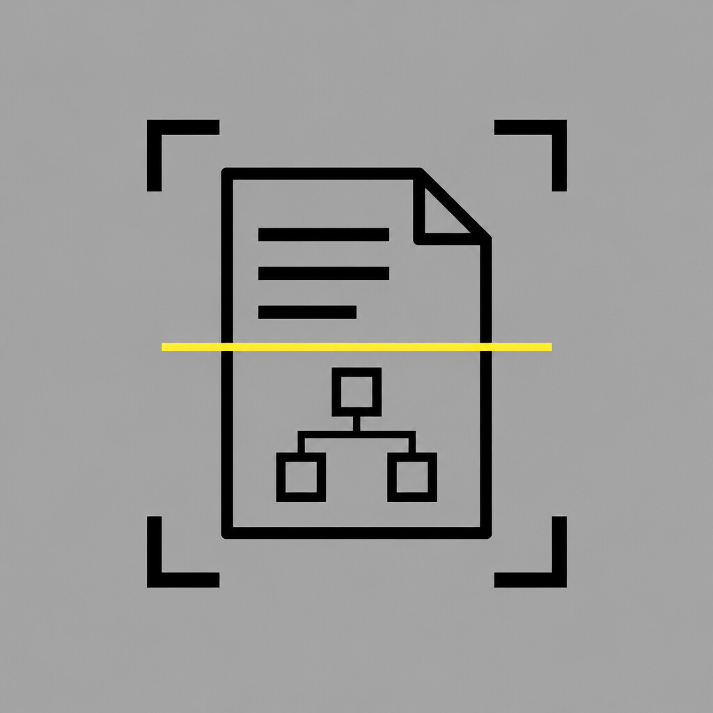
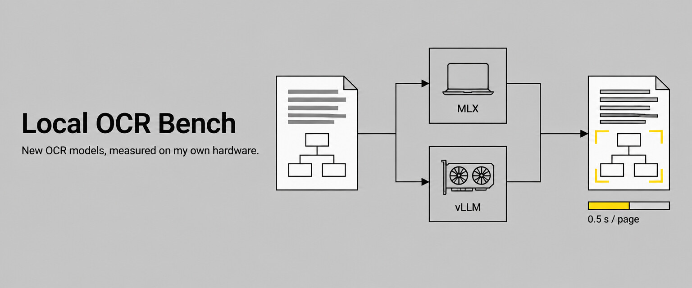
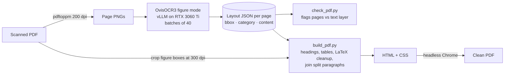

<p align="center">
  
</p>

<h1 align="center">Local OCR Bench</h1>

<p align="center">
  I benchmarked this month's new open OCR models on a MacBook (MLX) and on an RTX 3060 Ti (vLLM on Windows), then turned the winner into a scan-to-clean-PDF pipeline.
</p>

<p align="center">
  <a href="#results"><b>Results</b></a> ·
  <a href="#what-i-learned">What I learned</a> ·
  <a href="WINDOWS-VLLM.md">vLLM on Windows</a> ·
  <a href="BENCHMARK.md">Full method</a> ·
  <a href="#run-it">Run it</a>
</p>

<p align="center">
  
</p>

## Why

In November 2026 four OCR models came out within two weeks, and each one said it read diagrams, ran locally and was fast. I wanted to know which of those claims held up on hardware I own: a 16 GB MacBook Pro and a Windows desktop with an 8 GB RTX 3060 Ti. I also wanted to know whether any of them could turn an old scanned document into a clean, reformatted PDF without me reading every page.

The test set is 13 pages from a scanned print document from the 1990s: 4 pages of plain text, and 9 with diagrams, tables or forms. I wrote a hand-checked reference transcript for each page, plus a list of every label inside each figure. The pages and transcripts are copyrighted, so they aren't in this repo. The scripts work with any pages you supply.

## Results

### Mac: MacBook Pro M3, 16 GB, every model on MLX at 8-bit

| Model | s / page | Char error ↓ | Word F1 ↑ | Diagram labels found ↑ | Peak memory |
|---|---:|---:|---:|---:|---:|
| [**OvisOCR3**](https://huggingface.co/ATH-MaaS/OvisOCR3), figure mode | 12.9 | 0.145* | 0.885* | **98.9%** | 2.3 GB |
| [OvisOCR3](https://huggingface.co/ATH-MaaS/OvisOCR3), markdown mode | 8.4 | 0.078 | 0.945 | 54.8% | 2.3 GB |
| [MiniCPM-OCR 1.0](https://github.com/OpenBMB/MiniCPM-OCR), whole page | 11.3 | **0.046** | 0.989 | 78.7% | 3.7 GB |
| [MiniCPM-OCR 1.0](https://github.com/OpenBMB/MiniCPM-OCR), official SDK pipeline | 15.0 | 0.147 | 0.914 | 53.6% | 3.7 GB + layout model |
| [Unlimited-OCR-2](https://github.com/baidu/Unlimited-OCR) (3B) | 8.5 | 0.145 | 0.886 | 35.6% | 5.9 GB |
| [Mirage](https://huggingface.co/Cactus-Compute/mirage) ([Cactus](https://github.com/cactus-compute/cactus), 51M) | **0.22** | 0.552 | 0.598 | 57.8% | tiny |
| *Apple Vision (built into macOS), baseline* | 0.77 | 0.068 | **0.995** | 82.2% | n/a |

\* Figure mode moves the text inside a figure into a caption and Mermaid code, which the text columns don't count. On the plain-text pages OvisOCR3 matched the reference exactly in both modes.

### PC: RTX 3060 Ti 8 GB, OvisOCR3 at bf16

| Runtime | Markdown mode, 1 page at a time | Markdown, 13 pages per batch | Figure mode, 1 page at a time | Figure, 13 pages per batch |
|---|---:|---:|---:|---:|
| transformers + flash-linear-attention | 17.1 s | 3.3 s | 31.4 s | 4.4 s |
| **vLLM 0.32 ([Windows build](https://github.com/SystemPanic/vllm-windows))** | **2.3 s** | **0.50 s** | **3.9 s** | **0.53 s** |
| *Mac M3, MLX 8-bit, for comparison* | *8.4 s* | | *12.9 s* | |

Accuracy was the same on every runtime: character error 0.077 to 0.078 in markdown mode and 98.9% of diagram labels in figure mode.

**A 278-page scanned document took 3 minutes 11 seconds on the 3060 Ti with vLLM**, about 0.7 s per page in batches of 40 including image loading. The same job would take 40 to 60 minutes on the Mac, or roughly $7 to $12 through a frontier-model API.

## What I learned

**Check the "fast" claim against your own hardware.** MiniCPM-OCR's 1.2 pages per second is measured with its accelerated vLLM setup on an NVIDIA GPU. On a Mac it was the slowest of the LLM-based models. The smallest model, OvisOCR3 at 0.8B, was the fastest on both machines.

**Diagram support means different things.** Only OvisOCR3 in figure mode actually reads diagrams. It returns the layout as JSON with a box, a category and a caption for each figure, and Mermaid code for flowcharts. Every label it pulled out was correct, but some of the arrows in its Mermaid output are made up, so treat the connections as a draft. MiniCPM flattens diagram text into loose lines, and Unlimited-OCR-2 returns figures as empty boxes.

**The built-in Mac OCR is a strong baseline.** Apple Vision was about 10× faster than any of the LLM-based models and nearly as accurate on plain text. If you only need text from clean pages, start there.

**On Windows, the runtime matters more than the GPU.** With transformers, the 3060 Ti generated 22 tokens per second, slower than the Mac's 80. Most of that time was Python work between tokens. Batching 13 pages brought it to 3.3 s per page, and vLLM, with CUDA graphs and continuous batching, brought it to 0.5 s.

**vLLM runs on native Windows now, with three fixes.** The community build needed a one-character patch, a CUDA 13 runtime folder and one setting changed. I didn't need WSL. Details are in [WINDOWS-VLLM.md](WINDOWS-VLLM.md).

**OvisOCR3 is a hybrid-attention model.** It's built on Qwen3.5, which mixes Gated DeltaNet linear attention with full attention. Without the `flash-linear-attention` kernels, transformers quietly falls back to a slow reference path. Installing them on Windows (through `triton-windows`) gave about 14%. Most of the speedup came from batching and vLLM.

**Use the OCR model's layout, not the PDF's text layer.** The scan's existing ABBYY text layer had about 99% of the words right. It also had misreads, lost dialogue labels, words split at line ends, and junk from inside figures. It also has no structure, so it can't tell you where a figure is to crop it.

**Check quality without reading the output.** For the full document I never read the text. A script compared each page's OCR words with the PDF's text layer and flagged pages that disagreed, cut off early, came back empty or had strange figure boxes. Every one of the 36 flagged pages had a mundane cause: blank scans, small margin icons, a sideways table, and a page of math notation.

## Architecture



**One model for text and layout.** Figure mode returns every block with its position and category: header, page number, title, text, table, image or chart. That's enough to drop running headers, make real headings, keep tables as tables and crop figures straight from the scan. I didn't need a separate layout model.

**Figures are cropped, not described.** For a readable document, the original diagram beats a generated caption. The builder crops each figure's box from the source PDF at 300 dpi and drops the caption and Mermaid output.

**Same runner on every runtime.** `run_mlx.py`, `run_hf.py` and `run_vllm.py` use the same pages, prompts, untimed warm-up and timing, so the numbers compare directly. `score.py` scores every output folder with the same normalizer: format markup is stripped, so a model isn't penalised for returning HTML tables or JSON.

**Blank-page detection by ink, not variance.** Scanned blank pages have gutter shadows and paper texture, so pixel variance can't tell them apart from text. Counting dark pixels in the centre of the page separates them cleanly: blank pages have 0% ink, text pages 3 to 10%.

## Run it

### Mac (MLX)

```sh
python3 -m venv envs/mlx && envs/mlx/bin/pip install mlx-vlm rapidfuzz
# convert any model to 8-bit MLX
envs/mlx/bin/python -m mlx_vlm convert --hf-path ATH-MaaS/OvisOCR3 --mlx-path models/ovis-mlx-8bit -q --q-bits 8
# pages/p*.png = your test pages; prompts come from the model repo's prompts/ folder
envs/mlx/bin/python bench/run_mlx.py ovis_fig models/ovis-mlx-8bit ref/ovis_prompts/figure_captioning.txt
# score against your own references in ref/gt/*.txt and ref/diagram_labels.json
envs/mlx/bin/python bench/score.py
envs/mlx/bin/python bench/make_compare.py      # side-by-side HTML viewer
```

Apple Vision baseline: `swiftc bench/apple_vision_ocr.swift -o bench/apple_vision_ocr && bench/apple_vision_ocr page.png`

### Windows + NVIDIA (vLLM)

Follow [WINDOWS-VLLM.md](WINDOWS-VLLM.md), then:

```powershell
$env:CUDA_HOME="$PWD\cuda13"; $env:VLLM_USE_FLASHINFER_SAMPLER="0"
.\vvenv\Scripts\python bench\run_vllm.py                       # benchmark
.\vvenv\Scripts\python pipeline\ocr_pdf.py pages work\ocr      # a whole document
```

### Scan to clean PDF

```sh
pdftoppm -r 200 -png scan.pdf pages/p
python pipeline/ocr_pdf.py pages work/ocr            # on the GPU machine
python pipeline/check_pdf.py scan.pdf work           # flags pages worth a look
python pipeline/build_pdf.py scan.pdf work "Title"   # needs PyMuPDF
chrome --headless=new --no-pdf-header-footer --print-to-pdf=clean.pdf "file://$PWD/work/out.html"
```

## Project structure

```
bench/          run_mlx.py, run_hf.py, run_hf_batch.py, run_vllm.py, run_mirage.py,
                apple_vision_ocr.swift, score.py, make_compare.py (+ HTML template)
pipeline/       ocr_pdf.py, check_pdf.py, build_pdf.py, pdf.css
windows/        fix_vllm_syntax.py (patch for the vLLM Windows wheel)
results/        summary.json, every number in the tables above
BENCHMARK.md    method, metrics, per-figure-type results
WINDOWS-VLLM.md getting vLLM running on native Windows with an RTX 30-series card
```

Not in the repo, so put your own here: `pages/`, `ref/`, `models/`, `out/`, `envs/`.

## Hardware

| | Mac | PC |
|---|---|---|
| Machine | MacBook Pro, Apple M3 | Desktop |
| CPU | 8 cores (4P + 4E) | Intel Core i7-11700, 8 cores / 16 threads |
| GPU | 10-core integrated | NVIDIA GeForce RTX 3060 Ti, 8 GB GDDR6 (Ampere) |
| Memory | 16 GB unified | 32 GB DDR4-3200 |
| OS | macOS 26 | Windows 11 Pro, NVIDIA driver 610.60 |
| Runtime | MLX 0.32.4, mlx-vlm 0.7.12, Python 3.11 | vLLM 0.32.0 (Windows build), PyTorch 2.11 + CUDA 13, Python 3.12 |

The PC is driven from the Mac over SSH through Tailscale. The Mac sends the page images, runs the job remotely and pulls the results back.

## Tech stack

Python, MLX / mlx-vlm, PyTorch, transformers, vLLM, flash-linear-attention, triton-windows, PyMuPDF, RapidFuzz, Swift (Apple Vision), Mermaid, headless Chrome.

## Notes

MIT license for the code in this repo. The models keep their own licenses: OvisOCR3 and MiniCPM-OCR are Apache-2.0, and Unlimited-OCR-2 is MIT. Check each model card before commercial use. I'm not affiliated with any of the model authors, Apple or NVIDIA. Results come from 13 pages of one kind of document, so they're a guide for scanned print with diagrams, not a general leaderboard.
